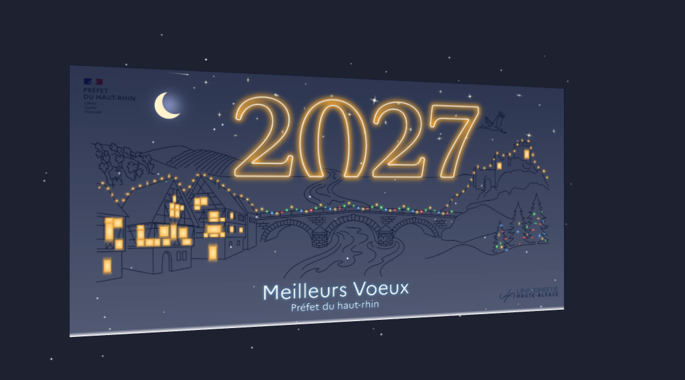

# Carte de vœux 2027 en réalité augmentée : la nuit d'hiver

Même carte que la version pop-up (la carte à colorier de la préfecture du Haut-Rhin), mais une histoire
complètement différente : **rien ne sort de la carte, c'est la lumière qui raconte**.

Quand on vise la carte avec un téléphone :

1. **La nuit tombe.** Un voile bleu nuit descend sur la carte comme un store, la lune se lève,
   les étoiles s'allument une à une et la neige commence à tomber.
2. **La cigogne apporte la lumière.** Elle traverse la carte de droite à gauche avec une lanterne au bec.
   Partout où elle passe, la ville s'allume : les guirlandes du château et les sapins de Noël,
   puis les néons du **2027** (ils grésillent avant de s'allumer, comme de vrais néons),
   les guirlandes du pont, et enfin les fenêtres et les toits des maisons.
3. **« Meilleurs Voeux » s'allume** en néon bleu quand la cigogne est partie.
   Deux étoiles filantes traversent le ciel.
4. **Le jour revient.** Les lumières s'éteignent de gauche à droite, le voile remonte et tout recommence.

L'animation dure 14 secondes et tourne en boucle. Tout se passe dans le navigateur, sans application.

**Site :** https://last64.github.io/CarteDeVoeux2/ (ouvrir sur le téléphone, autoriser la caméra, viser la carte)



La vidéo `apercu/apercu-animation-nuit.mp4` montre l'animation complète.

---

## Différences avec la version pop-up

| | Version pop-up (CarteDeVoeux) | Nuit d'hiver (CarteDeVoeux2) |
|---|---|---|
| Idée | Les éléments du dessin sortent de la carte, en couleurs | La carte reste à plat, c'est la lumière qui change |
| Ambiance | Jour, couleurs du coloriage | Nuit, néons, guirlandes, fenêtres allumées |
| Cigogne | S'envole puis revient se poser | Traverse la carte et allume la ville sur son passage |
| Neige | Flocons à 6 branches, bleu clair (pour se voir sur le papier blanc) | Flocons ronds blancs (ils se voient sur la nuit) |
| Technique principale | Position et rotation (profondeur, bascule, sinus) | Échelle 0 → 1 pour allumer et éteindre, paliers constants pour le grésillement |
| Cible MindAR | `targets.mind` | Le même fichier : c'est la même carte |

---

## La chaîne de fabrication

```
Dessin  →  images des lumières (Python)  →  Blender (animation)  →  carte.glb  →  page web A-Frame + MindAR  →  GitHub Pages
```

### 1. Les images des lumières : `blender/elements/`

Elles sont fabriquées par `blender/outils/preparer_elements.py` (Python, avec les bibliothèques Pillow et OpenCV), à partir du dessin
et des calques de la version pop-up :

- **Néons du 2027** (`neon_chiffre_*.png`) : le contour de chaque chiffre, avec un cœur blanc chaud et un halo doré flou.
- **Néon du texte** (`neon_texte.png`) : les lettres fines du dessin imprimé, avec un halo bleu.
- **Ampoules** (`ampoule_*.png`) : un point blanc entouré d'un halo de couleur (chaud, rouge, vert, bleu, or).
- **Fenêtre allumée** (`fenetre.png`), **lune**, **étoile**, **étoile filante**, **flocon**, **lanterne**.
- **Voile de nuit** (`voile_nuit.png`) : un bleu nuit transparent, plus foncé en haut, comme un vrai ciel.

Le script calcule aussi les positions, rangées dans `elements.json` :

- **Les fenêtres** sont trouvées automatiquement (`detecter_fenetres.py`) : dans le dessin, ce sont les petites zones blanches fermées
  et presque rectangulaires des maisons. Les deux fenêtres du château ont été ajoutées à la main.
- **Les guirlandes** suivent le haut des toits (le bord supérieur du calque des maisons et du château), avec une ampoule tous les 34 à 40 pixels.
  Sur le pont, elles pendent entre des piquets plantés sur le parapet (une demi-sinusoïde entre deux piquets).
- **Les sapins** reçoivent des ampoules de couleur posées au hasard dans leur silhouette, jamais trop près l'une de l'autre.

### 2. Blender : `blender/carte_nuit.blend`

Le script `blender/construire_nuit.py` (aussi rangé dans l'onglet *Scripting* du fichier) construit toute la scène.

**Les repères** (les mêmes que la version pop-up) : la carte fait **1 m de large** et elle est posée au sol.
+X = droite de la carte, +Y = haut de la carte, +Z = vers la personne qui regarde.
La collection *Carte imprimée* sert seulement de repère : elle est cachée au rendu, donc elle n'est pas exportée.

**Les collections**

| Collection | Contenu |
|---|---|
| 1 - La nuit tombe | Le voile, la lune, 26 étoiles |
| 2 - La cigogne et sa lanterne | Le vide *Cigogne*, ses 3 morceaux (corps, 2 ailes) et la lanterne |
| 3 - La ville s'allume | 5 néons, 37 fenêtres, 121 ampoules rangées par guirlande (maisons, château, pont, sapins) |
| 4 - Le ciel | 2 étoiles filantes |
| 5 - La neige | 64 flocons |

**Allumer et éteindre avec l'échelle.** Le glTF ne sait pas animer la transparence d'un matériau, mais il sait animer l'échelle.
Une lumière éteinte est donc à l'échelle 0,001 (invisible), et elle passe à 1 pour s'allumer, avec une interpolation **Back** (petit rebond).

**Le grésillement des néons** : des images clés en interpolation **Constant** (allumé, éteint, allumé, éteint, allumé),
comme un tube qui a du mal à démarrer. Ensuite, un sinus sur l'échelle (± 1,5 %) fait « respirer » le néon.

**La cigogne allume la ville.** Sa trajectoire est une liste de points (variable `VOL`).
La fonction `passage(x)` calcule à quelle image la cigogne passe au-dessus d'une position x de la carte :
chaque fenêtre, ampoule ou néon s'allume à ce moment-là (plus un petit délai). Si on change la trajectoire,
les lumières suivent toutes seules.

**Le voile de nuit** a son origine en haut de la carte : en passant de l'échelle Y 0 à 1, il descend comme un store.

**La neige** : chaque flocon a deux images clés linéaires (en haut, puis en bas de la carte),
répétées à l'infini par un modificateur de courbe **Cycles**. Un sinus sur X le fait se balancer.

**Les étoiles et les ampoules qui clignotent** : modificateurs sinus sur l'échelle, chacun avec sa période et son décalage.

**Les matériaux** sont sans ombre (nœuds *Light Path > Is Camera Ray* + *Emission*, exportés en `KHR_materials_unlit`)
et à transparence douce (`alphaMode BLEND`) : ce sont des lumières, leur halo doit se fondre dans la nuit.

**Le déroulé** (images à 24 i/s)

| Images | Ce qui se passe |
|---|---|
| 0 → 40 | Le voile de nuit descend |
| 18 → 64 | La lune se lève |
| 26 → 80 | Les étoiles s'allument une à une, puis scintillent |
| 30 → 62 | La neige commence à tomber |
| 44 → 196 | La cigogne traverse la carte avec sa lanterne |
| ~55 → 85 | Guirlandes du château et des sapins |
| ~89 → 144 | Néons 7, 2, 0, 2 (avec grésillement) |
| ~85 → 145 | Guirlandes du pont |
| ~140 → 200 | Fenêtres et guirlandes des maisons |
| 204 | « Meilleurs Voeux » s'allume |
| 228 → 278 | Deux étoiles filantes |
| 290 → 306 | Les lumières s'éteignent de gauche à droite |
| 300 → 330 | Le voile remonte : le jour revient |
| 336 | Comme l'image 0 : la boucle ne se voit pas |

**L'export** : *Fichier > Exporter > glTF 2.0* (ou la fonction `exporter_glb()` du script)

- Format : **glTF Binary (.glb)** → `assets/carte.glb`
- Inclure : **Renderable Objects** (la carte repère n'est pas exportée)
- Transformation : **+Y Up**
- Animation : mode **Scene**, *Split by Object* décoché, *Always Sample Animations* coché
  (les sinus, les cycles et les paliers constants sont « cuits » image par image)

### 3. La page web : `index.html`

Les mêmes bibliothèques que la version pop-up : **A-Frame 1.7.0**, **MindAR 1.2.5** et **aframe-extras 7.6.0** (`animation-mixer`).
La cible `assets/targets.mind` est la même, puisque c'est la même carte.

En plus, `ordre-lumieres.js` fixe l'**ordre d'affichage** des images transparentes : d'abord le voile,
puis le ciel, les fenêtres, les néons, les ampoules, et enfin la cigogne et la neige.
Sans lui, three.js trie les objets transparents d'après leur distance à la caméra et, selon l'angle du téléphone,
le voile pourrait passer devant une fenêtre et l'éteindre.

`apercu.html` montre la même scène **sans caméra**, la carte de face qui pivote doucement :
pratique pour tester sur un ordinateur, ou en secours pendant une présentation.

### 4. La mise en ligne

La caméra ne fonctionne qu'en **https**, d'où GitHub Pages :
*Settings > Pages > Source : Deploy from a branch > Branch : main, dossier / (root) > Save*.

---

## Tester

- **Sur ordinateur** : ouvrir le dossier dans VS Code, puis *clic droit sur `apercu.html` > Open with Live Server*.
- **Sur téléphone** : ouvrir le lien GitHub Pages et viser la carte (`impression/carte-a-imprimer.png`).
  Elle doit être bien éclairée et entièrement visible au début.

## Modifier

- **Le déroulé ou la trajectoire de la cigogne** : changer les valeurs en haut de `construire_nuit.py`
  (`VOL`, `TEXTE_ON`, `EXTINCTION`…), lancer le script, puis réexporter.
- **Les couleurs ou les lumières** : modifier `preparer_elements.py`, le relancer, puis relancer `construire_nuit.py`.

## Questions possibles à l'oral

- **Pourquoi l'échelle pour allumer une lumière ?** Le glTF peut animer la position, la rotation, l'échelle et les clés de forme,
  mais pas l'opacité d'un matériau. Passer de 0 à 1 en échelle avec un petit rebond donne l'effet d'une ampoule qui s'allume.
- **Comment la cigogne « allume » la ville ?** Les lumières ne sont pas reliées à la cigogne. Le script calcule, pour chaque lumière,
  l'image où la cigogne passe au-dessus d'elle, et place l'image clé d'allumage à ce moment-là.
- **Pourquoi un voile plutôt que de recolorier la carte ?** On ne peut pas changer les couleurs de la vraie carte filmée.
  Un plan bleu nuit transparent posé dessus l'assombrit, et le dessin reste visible à travers.
- **Pourquoi des flocons blancs ici et bleus dans l'autre version ?** Sur la nuit, le blanc se voit très bien.
  Sur le papier blanc de la version de jour, il fallait du bleu.
- **Pourquoi un modificateur Cycles pour la neige ?** Une chute = 2 images clés. Le modificateur la répète à l'infini :
  pas besoin de poser des dizaines d'images clés par flocon.
